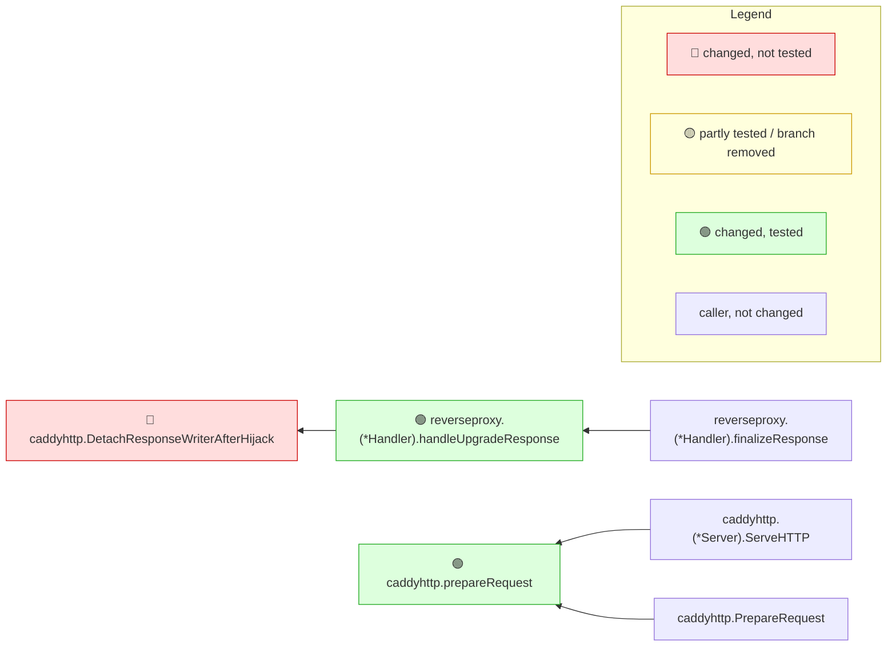

# caddyserver/caddy #8346

- **Repository:** [caddyserver/caddy](https://github.com/caddyserver/caddy)
- **Pull request:** [https://github.com/caddyserver/caddy/pull/8346](https://github.com/caddyserver/caddy/pull/8346) — caddyhttp: detach streams at the server writer boundary
- **Merged as:** squash commit on `master`, 2026-11-04
- **Range:** `644dbe695d295a5f2feef017d9f04b3220aef2b0..fbfc061e70d51f17b8004a71aed88dbd2a41f70e`
- **Toolchain:** `go version go1.26.0 linux/amd64`; mrimpact built from this repository (version in the note's last line)
- **Coverage mode:** coverprofile

## Commands

```sh
git clone --filter=blob:none https://github.com/caddyserver/caddy.git caddy
cd caddy
git checkout --detach fbfc061e70d51f17b8004a71aed88dbd2a41f70e
HOME=$PWD/../home XDG_CONFIG_HOME=$PWD/../home/.config XDG_DATA_HOME=$PWD/../home/.local/share \
  go test ./... -coverprofile=../caddy-8346.cov
mrimpact --base 644dbe695d295a5f2feef017d9f04b3220aef2b0 --no-post --out ../caddy-8346.md --coverprofile ../caddy-8346.cov
```

Tests: 25 s (46 s on a cold build cache). `HOME` and the XDG directories point into a throwaway directory because caddy's integration tests write an autosaved config and a local CA under the home directory. Two tests fail in this environment and the profile is still written: `TestSystemdListenFDIntegration` (needs a `caddy` binary in `PATH`) and `TestServer_ClosedRequestBodyDoesNotDesyncHTTP1` in `modules/caddyhttp`; the exit status also reflects the missing `covdata` tool. mrimpact: 9 s (23 s on the first, static run).

## What a reviewer learns

The one 🔴 row, `DetachResponseWriterAfterHijack`, is not about tests: 84 % of its added lines are covered. It is red because an exported function of an importable package changed its signature (it takes a new `*http.Request`), so third-party Caddy modules that call it stop compiling on upgrade; the rules line at the bottom says so, while the diagram legend's "🔴 changed, not tested" does not. The callers show that inside Caddy only the reverse proxy's upgrade path uses it, and the entry points show that this path is reached from any server started through the admin API or the CLI.

## The note

The note below is mrimpact's output, unedited.

---

<!-- mrimpact:v1 -->
### 🔍 MR impact — 3 functions changed
**🔴 1 · 🟡 0 · 🟢 2** · coverage: `coverprofile` · base `644dbe6`

| Risk | Function | Change | Callers | Entry points | Added-line coverage |
|---|---|---|---|---|---|
| 🔴 | `caddyhttp.DetachResponseWriterAfterHijack` | signature (exported) | 2 | `WrapCommandFuncForCobra(…)`, `addRoute("/" + rawConfigKey + "/", handlerLabel, …)` +18 | 84 % (21/25) |
| 🟢 | `reverseproxy.(*Handler).handleUpgradeResponse` | body | 3 | `WrapCommandFuncForCobra(…)`, `addRoute("/" + rawConfigKey + "/", handlerLabel, …)` +18 | 100 % (2/2) |
| 🟢 | `caddyhttp.prepareRequest` | body | 2 | api `caddyhttp.(*Server).ServeHTTP`, api `caddyhttp.PrepareRequest` | 100 % (3/3) |

📝 Declarations changed: `type responseWriterBoundaryCtxKeyType in modules/caddyhttp/responsewriter.go`, `var responseWriterBoundaryCtxKey in modules/caddyhttp/responsewriter.go`

🧪 Tests touched in this MR: `modules/caddyhttp/responsewriter_test.go`, `modules/caddyhttp/reverseproxy/streaming_test.go`

**How to read the diagram:** coloured boxes are functions this MR changed (🔴 not tested · 🟡 partly tested or a branch removed · 🟢 tested); plain boxes are callers the MR did not change; an arrow points from a caller to the function it calls; a dashed arrow means the function is passed as a callback (registered) and called through it. Every caller is listed under *All callers*.



<details><summary>All callers (7)</summary>

**`caddyhttp.DetachResponseWriterAfterHijack`** (2)

- depth 1: `reverseproxy.(*Handler).handleUpgradeResponse`
- depth 2: `reverseproxy.(*Handler).finalizeResponse`

**`reverseproxy.(*Handler).handleUpgradeResponse`** (3)

- depth 1: `reverseproxy.(*Handler).finalizeResponse`
- depth 2: `reverseproxy.(*Handler).reverseProxy`, `reverseproxy.CopyResponseHandler.ServeHTTP`

**`caddyhttp.prepareRequest`** (2)

- depth 1: `caddyhttp.(*Server).ServeHTTP`, `caddyhttp.PrepareRequest`

</details>

<details><summary>⚠️ Limits of this analysis</summary>

- Calls via `reflect` or dynamic registration (e.g. handlers by name) are not detected.
- This repo only: callers in other services (HTTP/gRPC) are not visible.
- Functions called only from dependencies (e.g. HTTP handlers registered with net/http) or from package-level initializers show no callers; where such a function is registered is listed under Registered.
- Now unused: uses through `reflect`, `//go:linkname` or other repositories are not seen; exported methods, and exported functions of packages other modules can import, are never listed.
</details>

<sub>Rules: 🔴 untested with callers, or exported signature changed in an importable package · 🟡 partial, untested with no callers, or a branch removed · 🟢 covered (no added lines: reached by a test) · wiring (straight-line setup) at most 🟡 · sensitive and untested 🔴 · mrimpact v0.0.0-20261110090449-8d3c242fab2c · 8.7 s</sub>
