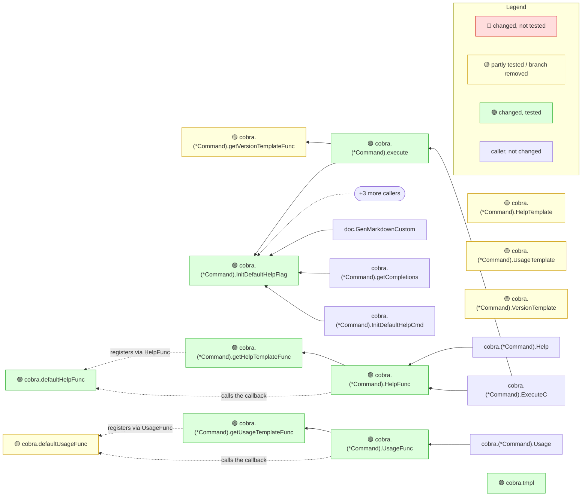

# spf13/cobra #1956

- **Repository:** [spf13/cobra](https://github.com/spf13/cobra)
- **Pull request:** [https://github.com/spf13/cobra/pull/1956](https://github.com/spf13/cobra/pull/1956) — Allow linker to perform deadcode elimination for program using Cobra
- **Merged as:** squash commit on `main`, 2025-01-27 (older than the other examples: cobra's pull requests of the last twelve months each change one or two lines of one function)
- **Range:** `09d5664f34e3f7571560e48ccb74c8904b671e87..611e16c322e3b0413a9ba4e489fcd98ef904e406`
- **Toolchain:** `go version go1.26.0 linux/amd64`; mrimpact built from this repository (version in the note's last line)
- **Coverage mode:** coverprofile

## Commands

```sh
git clone --filter=blob:none https://github.com/spf13/cobra.git cobra
cd cobra
git checkout --detach 611e16c322e3b0413a9ba4e489fcd98ef904e406
go test ./... -coverprofile=../cobra-1956.cov
mrimpact --base 09d5664f34e3f7571560e48ccb74c8904b671e87 --no-post --out ../cobra-1956.md --coverprofile ../cobra-1956.cov
```

Tests: 7 s, all tests pass. mrimpact: under 1 s (2 s on the first, static run).

## What a reviewer learns

The PR takes `text/template` out of cobra's default help, usage and version output, because executing a template calls `MethodByName` and that disables the linker's dead-code elimination. The 🔐 section names the one function that still executes a template, `cobra.tmpl`, and its entry points are only `SetHelpTemplate`, `SetUsageTemplate` and `SetVersionTemplate`: the template path now runs only when a program sets a custom template, which is the PR's goal, seen without reading the diff. The 🟡 rows are partly covered new defaults and three exported getters (`HelpTemplate`, `UsageTemplate`, `VersionTemplate`) whose changed lines no test runs (0/3 each).

## The note

The note below is mrimpact's output, unedited.

---

<!-- mrimpact:v1 -->
### 🔍 MR impact — 18 functions changed
**🔴 0 · 🟡 5 · 🟢 13** · coverage: `coverprofile` · base `09d5664`

🔐 **Sensitive code changed** (1):

- 🟢 `cobra.tmpl` — text/template.(*Template).Execute · 100 % (9/9)

| Risk | Function | Change | Callers | Registered | Entry points | Added-line coverage |
|---|---|---|---|---|---|---|
| 🟡 | `cobra.(*Command).getVersionTemplateFunc` | new | 2 |  | api `cobra.(*Command).Execute`, api `cobra.(*Command).ExecuteC` +2 | 75 % (6/8) |
| 🟡 | `cobra.defaultUsageFunc` | new | 2 | `command.go:459` | `command.go:459`, `command.go:501` +18 | 89 % (51/57) |
| 🟡 | `cobra.(*Command).HelpTemplate` | body | 0 |  | api `cobra.(*Command).HelpTemplate` | 0 % (0/3) |
| 🟡 | `cobra.(*Command).UsageTemplate` | body | 0 |  | api `cobra.(*Command).UsageTemplate` | 0 % (0/3) |
| 🟡 | `cobra.(*Command).VersionTemplate` | body | 0 |  | api `cobra.(*Command).VersionTemplate` | 0 % (0/3) |
| 🟢 | `cobra.(*Command).InitDefaultHelpFlag` | body | 16 (2 pkgs) |  | api `cobra.(*Command).Execute`, api `cobra.(*Command).ExecuteC` +18 | 100 % (3/3) |
| 🟢 | `cobra.(*Command).HelpFunc` | body | 5 |  | api `cobra.(*Command).Execute`, api `cobra.(*Command).ExecuteC` +18 | 100 % (2/2) |
| 🟢 | `cobra.(*Command).UsageFunc` | body | 3 |  | `command.go:501`, api `cobra.(*Command).Execute` +18 | 100 % (2/2) |
| 🟢 | `cobra.(*Command).execute` | body | 3 |  | api `cobra.(*Command).Execute`, api `cobra.(*Command).ExecuteC` +2 | 100 % (3/3) |
| 🟢 | `cobra.(*Command).getHelpTemplateFunc` | new | 3 |  | api `cobra.(*Command).Execute`, api `cobra.(*Command).ExecuteC` +18 | 100 % (8/8) |
| 🟢 | `cobra.tmpl` | signature · wiring · sensitive | 3 |  | api `cobra.(*Command).SetHelpTemplate`, api `cobra.(*Command).SetUsageTemplate` +1 | 100 % (9/9) |
| 🟢 | `cobra.(*Command).getUsageTemplateFunc` | new | 2 |  | `command.go:501`, api `cobra.(*Command).Execute` +18 | 100 % (8/8) |
| 🟢 | `cobra.defaultHelpFunc` | new | 2 | `command.go:501` | `command.go:501`, api `cobra.(*Command).Execute` +18 | 100 % (15/15) |
| 🟢 | `cobra.defaultVersionFunc` | new | 2 | `command.go:626` | `command.go:626`, api `cobra.(*Command).Execute` +3 | 100 % (5/5) |
| 🟢 | `cobra.helpOrVersionFlagPresent` | body | 2 |  | api `cobra.(*Command).Execute`, api `cobra.(*Command).ExecuteC` +2 | 100 % (1/1) |
| 🟢 | `cobra.(*Command).SetHelpTemplate` | body · wiring | 0 |  | api `cobra.(*Command).SetHelpTemplate` | 100 % (1/1) |
| 🟢 | `cobra.(*Command).SetUsageTemplate` | body · wiring | 0 |  | api `cobra.(*Command).SetUsageTemplate` | 100 % (1/1) |
| 🟢 | `cobra.(*Command).SetVersionTemplate` | body · wiring | 0 |  | api `cobra.(*Command).SetVersionTemplate` | 100 % (1/1) |

📝 Declarations changed: 7 in 1 file

<details><summary>Declarations (7)</summary>

- `command.go` (7): `const helpFlagName`, `const helpCommandName`, `type Command`, `type tmplFunc`, `var defaultUsageTemplate`, `var defaultHelpTemplate`, `var defaultVersionTemplate`

</details>

🧪 Tests touched in this MR: `cobra_test.go`, `command_test.go`

**How to read the diagram:** coloured boxes are functions this MR changed (🔴 not tested · 🟡 partly tested or a branch removed · 🟢 tested); plain boxes are callers the MR did not change; an arrow points from a caller to the function it calls; a dashed arrow means the function is passed as a callback (registered) and called through it. Every caller is listed under *All callers*.



5 more changed functions are not drawn; see the table.

<details><summary>All callers (45)</summary>

**`cobra.(*Command).getVersionTemplateFunc`** (2)

- depth 1: `cobra.(*Command).execute`
- depth 2: `cobra.(*Command).ExecuteC`

**`cobra.defaultUsageFunc`** (2)

- registered: `command.go:459` — `command.go:459`
- depth 1: `cobra.(*Command).UsageFunc`
- depth 2: `cobra.(*Command).getUsageTemplateFunc`

**`cobra.(*Command).InitDefaultHelpFlag`** (16)

- depth 1: `cobra.(*Command).InitDefaultHelpCmd`, `cobra.(*Command).execute`, `cobra.(*Command).getCompletions`, `doc.GenMarkdownCustom`, `doc.GenReSTCustom`, `doc.GenYamlCustom`, `doc.genMan`
- depth 2: `cobra.(*Command).ExecuteC`, `cobra.(*Command).initCompleteCmd`, `doc.GenMan`
- and 6 more

**`cobra.(*Command).HelpFunc`** (5)

- depth 1: `cobra.(*Command).ExecuteC`, `cobra.(*Command).Help`
- depth 2: `cobra.(*Command).Execute`, `cobra.(*Command).ExecuteContextC`, `cobra.(*Command).InitDefaultHelpCmd`

**`cobra.(*Command).UsageFunc`** (3)

- depth 1: `cobra.(*Command).Usage`
- depth 2: `cobra.(*Command).InitDefaultHelpCmd`, `cobra.(*Command).UsageString`

**`cobra.(*Command).execute`** (3)

- depth 1: `cobra.(*Command).ExecuteC`
- depth 2: `cobra.(*Command).Execute`, `cobra.(*Command).ExecuteContextC`

**`cobra.(*Command).getHelpTemplateFunc`** (3)

- depth 1: `cobra.(*Command).HelpFunc`
- depth 2: `cobra.(*Command).ExecuteC`, `cobra.(*Command).Help`

**`cobra.tmpl`** (3)

- depth 1: `cobra.(*Command).SetHelpTemplate`, `cobra.(*Command).SetUsageTemplate`, `cobra.(*Command).SetVersionTemplate`

**`cobra.(*Command).getUsageTemplateFunc`** (2)

- depth 1: `cobra.(*Command).UsageFunc`
- depth 2: `cobra.(*Command).Usage`

**`cobra.defaultHelpFunc`** (2)

- registered: `command.go:501` — `command.go:501`
- depth 1: `cobra.(*Command).HelpFunc`
- depth 2: `cobra.(*Command).getHelpTemplateFunc`

**`cobra.defaultVersionFunc`** (2)

- registered: `command.go:626` — `command.go:626`
- depth 1: `cobra.(*Command).execute`
- depth 2: `cobra.(*Command).getVersionTemplateFunc`

**`cobra.helpOrVersionFlagPresent`** (2)

- depth 1: `cobra.(*Command).getCompletions`
- depth 2: `cobra.(*Command).initCompleteCmd`

</details>

<details><summary>⚠️ Limits of this analysis</summary>

- Calls via `reflect` or dynamic registration (e.g. handlers by name) are not detected.
- This repo only: callers in other services (HTTP/gRPC) are not visible.
- Functions called only from dependencies (e.g. HTTP handlers registered with net/http) or from package-level initializers show no callers; where such a function is registered is listed under Registered.
- Now unused: uses through `reflect`, `//go:linkname` or other repositories are not seen; exported methods, and exported functions of packages other modules can import, are never listed.
</details>

<sub>Rules: 🔴 untested with callers, or exported signature changed in an importable package · 🟡 partial, untested with no callers, or a branch removed · 🟢 covered (no added lines: reached by a test) · wiring (straight-line setup) at most 🟡 · sensitive and untested 🔴 · mrimpact v0.0.0-20261110090449-8d3c242fab2c · 0.4 s</sub>
