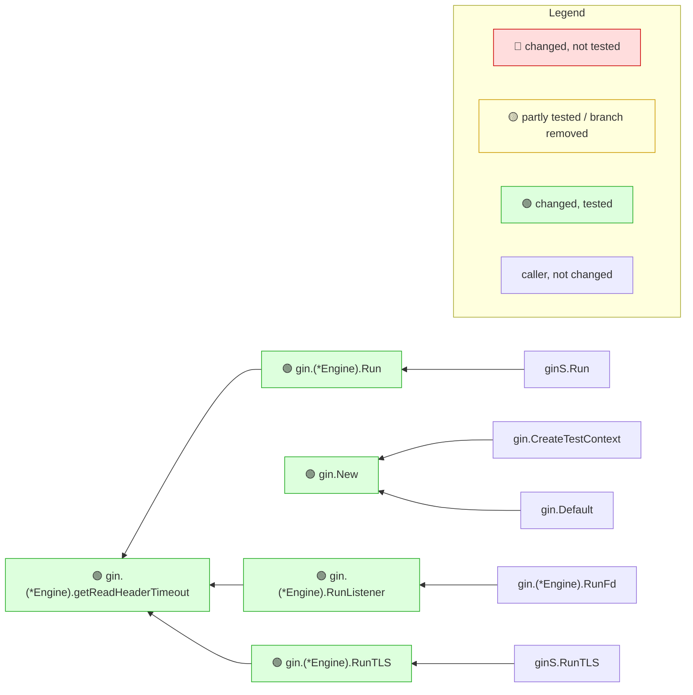

# gin-gonic/gin #4800

- **Repository:** [gin-gonic/gin](https://github.com/gin-gonic/gin)
- **Pull request:** [https://github.com/gin-gonic/gin/pull/4800](https://github.com/gin-gonic/gin/pull/4800) — fix(engine): add default ReadHeaderTimeout to http.Server in Run methods
- **Merged as:** squash commit on `master`, 2026-09-19
- **Range:** `8ad9f9cbeab45887327608f393bb614187e06099..d8f2d588d7573b3438cfc95b7a47f9ec8966273c`
- **Toolchain:** `go version go1.26.0 linux/amd64`; mrimpact built from this repository (version in the note's last line)
- **Coverage mode:** coverprofile

## Commands

```sh
git clone --filter=blob:none https://github.com/gin-gonic/gin.git gin
cd gin
git checkout --detach d8f2d588d7573b3438cfc95b7a47f9ec8966273c
go test ./... -coverprofile=../gin-4800.cov
mrimpact --base 8ad9f9cbeab45887327608f393bb614187e06099 --no-post --out ../gin-4800.md --coverprofile ../gin-4800.cov
```

Tests: 16 s. All tests pass; the exit status is 1 only because this toolchain has no `covdata` tool (`go: no such tool "covdata"` for `codec/json`, a package without tests). mrimpact: 1 s (2 s on the first, static run).

## What a reviewer learns

The PR gives the `http.Server` that `Run`, `RunTLS` and `RunListener` build a 10 s `ReadHeaderTimeout`. The note lists those three under 🔐 because they call `net/http.(*Server)` methods, shows every added line covered, and its entry points show that the change also reaches the `ginS` package's `Run`, `RunTLS` and `RunFd` wrappers. What the note makes checkable without saying it: the only callers of the new `getReadHeaderTimeout` are `Run`, `RunListener` and `RunTLS`, so `Engine.RunUnix` (`gin.go:609`), which builds its own `http.Server`, still has no `ReadHeaderTimeout` at this commit.

## The note

The note below is mrimpact's output, unedited.

---

<!-- mrimpact:v1 -->
### 🔍 MR impact — 5 functions changed
**🔴 0 · 🟡 0 · 🟢 5** · coverage: `coverprofile` · base `8ad9f9c`

🔐 **Sensitive code changed** (3):

- 🟢 `gin.(*Engine).Run` — net/http.(*Server).ListenAndServe · 100 % (3/3)
- 🟢 `gin.(*Engine).RunListener` — net/http.(*Server).Serve · 100 % (2/2)
- 🟢 `gin.(*Engine).RunTLS` — net/http.(*Server).ListenAndServeTLS · 100 % (3/3)

| Risk | Function | Change | Callers | Entry points | Added-line coverage |
|---|---|---|---|---|---|
| 🟢 | `gin.(*Engine).getReadHeaderTimeout` | new | 6 (2 pkgs) | api `gin.(*Engine).Run`, api `gin.(*Engine).RunFd` +5 | 100 % (5/5) |
| 🟢 | `gin.(*Engine).RunListener` | body · sensitive | 2 (2 pkgs) | api `gin.(*Engine).RunFd`, api `gin.(*Engine).RunListener` +1 | 100 % (2/2) |
| 🟢 | `gin.New` | body · wiring | 2 | api `gin.CreateTestContext`, api `gin.Default` +1 | 100 % (1/1) |
| 🟢 | `gin.(*Engine).Run` | body · sensitive | 1 | api `gin.(*Engine).Run`, api `ginS.Run` | 100 % (3/3) |
| 🟢 | `gin.(*Engine).RunTLS` | body · sensitive | 1 | api `gin.(*Engine).RunTLS`, api `ginS.RunTLS` | 100 % (3/3) |

📝 Declarations changed: `const defaultReadHeaderTimeout in gin.go`, `type Engine in gin.go`

🧪 Tests touched in this MR: `gin_test.go`

**How to read the diagram:** coloured boxes are functions this MR changed (🔴 not tested · 🟡 partly tested or a branch removed · 🟢 tested); plain boxes are callers the MR did not change; an arrow points from a caller to the function it calls; a dashed arrow means the function is passed as a callback (registered) and called through it. Every caller is listed under *All callers*.



<details><summary>All callers (12)</summary>

**`gin.(*Engine).getReadHeaderTimeout`** (6)

- depth 1: `gin.(*Engine).Run`, `gin.(*Engine).RunListener`, `gin.(*Engine).RunTLS`
- depth 2: `gin.(*Engine).RunFd`, `ginS.Run`, `ginS.RunTLS`

**`gin.(*Engine).RunListener`** (2)

- depth 1: `gin.(*Engine).RunFd`
- depth 2: `ginS.RunFd`

**`gin.New`** (2)

- depth 1: `gin.CreateTestContext`, `gin.Default`

**`gin.(*Engine).Run`** (1)

- depth 1: `ginS.Run`

**`gin.(*Engine).RunTLS`** (1)

- depth 1: `ginS.RunTLS`

</details>

<details><summary>⚠️ Limits of this analysis</summary>

- Calls via `reflect` or dynamic registration (e.g. handlers by name) are not detected.
- This repo only: callers in other services (HTTP/gRPC) are not visible.
- Functions called only from dependencies (e.g. HTTP handlers registered with net/http) or from package-level initializers show no callers; where such a function is registered is listed under Registered.
- Now unused: uses through `reflect`, `//go:linkname` or other repositories are not seen; exported methods, and exported functions of packages other modules can import, are never listed.
</details>

<sub>Rules: 🔴 untested with callers, or exported signature changed in an importable package · 🟡 partial, untested with no callers, or a branch removed · 🟢 covered (no added lines: reached by a test) · wiring (straight-line setup) at most 🟡 · sensitive and untested 🔴 · mrimpact v0.0.0-20261110090449-8d3c242fab2c · 0.7 s</sub>
