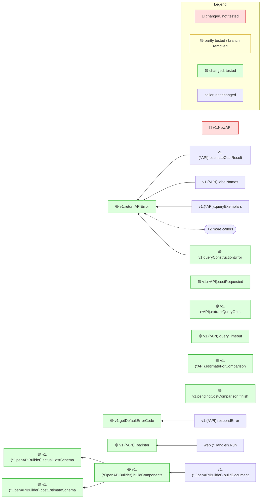

# prometheus/prometheus #20028

- **Repository:** [prometheus/prometheus](https://github.com/prometheus/prometheus)
- **Pull request:** [https://github.com/prometheus/prometheus/pull/20028](https://github.com/prometheus/prometheus/pull/20028) — Merge pull request #20028 from prometheus/roidelapluie/query-cost-api
- **Merged as:** merge commit on `main`, 2026-10-20; base is its first parent
- **Range:** `cd8e85f32e94e5f8890c65b95a6176d367bc572f..afa1fdebab3d56eab4527a1a1d5bc9f31a6978d6`
- **Toolchain:** `go version go1.26.0 linux/amd64`; mrimpact built from this repository (version in the note's last line)
- **Coverage mode:** static

## Commands

```sh
git clone --filter=blob:none https://github.com/prometheus/prometheus.git prometheus
cd prometheus
git checkout --detach afa1fdebab3d56eab4527a1a1d5bc9f31a6978d6
mrimpact --base cd8e85f32e94e5f8890c65b95a6176d367bc572f --no-post --out ../prometheus-20028.md
```

Tests: Not run: prometheus's `go test ./...` takes well over five minutes, so the note is in static mode (test reach from the call graph, no line coverage). mrimpact: 444 s on the first run with a cold build cache (the type-check of the whole module), 17 s on a re-run.

## What a reviewer learns

The PR adds query-cost endpoints to the HTTP API. The note lists the new routes registered through `wrapAgent` (`queryCost` and `queryRangeCost`, two registrations each), the one 🔴 row (`v1.NewAPI`, an exported constructor of an importable package, gained two parameters, which breaks projects that build the API themselves), and an inferred architecture hint with the coupling of `web/api/v1`. **One misfire, kept as it came out:** the two "Registrations removed, no replacement" lines are wrong. The `NewAPI(…)` call in `web/web.go` still passes `h.runtimeInfo` and `h.testReady`; it only got two more arguments, so its text changed and the same registrations show as removed and added. Fixed in Unreleased: it now shows under "Registrations changed".

## The note

The note below is mrimpact's output, unedited.

---

<!-- mrimpact:v1 -->
### 🔍 MR impact — 43 functions changed
**🔴 1 · 🟡 0 · 🟢 32** · coverage: `static` · base `cd8e85f`\
+10 new functions folded into 5 groups

🔌 **Registrations removed, no replacement** — these calls no longer get a handler; check each is intended (2, positions in base):

- `NewAPI(h.queryEngine, h.storage, appV2, h.exemplarStorage, factorySPr, factoryTr, factory…` → `web.(*Handler).runtimeInfo` — `web/web.go:393`
- `NewAPI(h.queryEngine, h.storage, appV2, h.exemplarStorage, factorySPr, factoryTr, factory…` → `web.(*Handler).testReady` — `web/web.go:393`

🔌 **Registrations added** (6, positions in head):

- `wrapAgent(…)` → `v1.(*API).queryCost` — `web/api/v1/api.go:489`
- `wrapAgent(…)` → `v1.(*API).queryCost` — `web/api/v1/api.go:490`
- `wrapAgent(…)` → `v1.(*API).queryRangeCost` — `web/api/v1/api.go:491`
- `wrapAgent(…)` → `v1.(*API).queryRangeCost` — `web/api/v1/api.go:492`
- `NewAPI(h.queryEngine, h.storage, appV2, h.exemplarStorage, factorySPr, factoryTr, factory…` → `web.(*Handler).runtimeInfo` — `web/web.go:395`
- `NewAPI(h.queryEngine, h.storage, appV2, h.exemplarStorage, factorySPr, factoryTr, factory…` → `web.(*Handler).testReady` — `web/web.go:395`

🏛 **Architecture (inferred — hints, not enforced)** · conformance 100.0 % → 100.0 % · 24/113 packages classified · layers: `cmd/prometheus` → entry, `web` → adapters, `web/api/v1` → adapters

<details><summary>Coupling (1 package changed)</summary>

| Package | Ca | Ce | I | A | D |
|---|---|---|---|---|---|
| `web/api/v1` | 1 → 1 | 22 → 22 | 0.96 → 0.96 | 0.11 → 0.11 | 0.07 → 0.06 |

</details>

All changes shown are reached from: main

| Risk | Function | Change | Callers | Registered | Entry points | Added-line coverage |
|---|---|---|---|---|---|---|
| 🔴 | `v1.NewAPI` | signature (exported) | 2 (2 pkgs) |  | api `v1.NewAPI`, api `web.New` | reached by test |
| 🟢 | `v1.returnAPIError` | body | 13 |  | `NewAPI(h.queryEngine, h.storage, appV2, h.exemplarStorage, factorySPr, factoryTr, factory…`, `ready(…)` +5 | reached by test |
| 🟢 | `v1.getDefaultErrorCode` | body | 9 |  | `Get("/notifications", …)`, `Get("/status/walreplay", …)` +6 | reached by test |
| 🟢 | `v1.(*API).costRequested` | new | 5 |  | `wrapAgent(…)`, api `v1.(*API).Register` +1 | reached by test |
| 🟢 | `v1.(*API).extractQueryOpts` | new · +1 | 5 |  | `wrapAgent(…)`, api `v1.(*API).Register` +1 | reached by test |
| 🟢 | `v1.(*API).queryTimeout` | new | 5 |  | `wrapAgent(…)`, api `v1.(*API).Register` +1 | reached by test |
| 🟢 | `v1.(*API).estimateForComparison` | new · +5 | 3 |  | `wrapAgent(…)`, api `v1.(*API).Register` +1 | reached by test |
| 🟢 | `v1.pendingCostComparison.finish` | new | 3 |  | `wrapAgent(…)`, api `v1.(*API).Register` +1 | reached by test |
| 🟢 | `v1.queryConstructionError` | new | 3 |  | `wrapAgent(…)`, api `v1.(*API).Register` +1 | reached by test |
| 🟢 | `v1.(*API).Register` | body | 2 (2 pkgs) |  | api `v1.(*API).Register`, api `web.(*Handler).Run` | reached by test |
| 🟢 | `v1.(*OpenAPIBuilder).actualCostSchema` | new | 2 |  | api `v1.NewAPI`, api `v1.NewOpenAPIBuilder` +1 | reached by test |
| 🟢 | `v1.(*OpenAPIBuilder).buildComponents` | body | 2 |  | api `v1.NewAPI`, api `v1.NewOpenAPIBuilder` +1 | reached by test |
| 🟢 | `v1.(*OpenAPIBuilder).costEstimateSchema` | new | 2 |  | api `v1.NewAPI`, api `v1.NewOpenAPIBuilder` +1 | reached by test |
| 🟢 | `v1.(*OpenAPIBuilder).getAllPathDefinitions` | body | 2 |  | api `v1.NewAPI`, api `v1.NewOpenAPIBuilder` +1 | reached by test |
| 🟢 | `v1.(*OpenAPIBuilder).queryCostComparisonSchema` | new | 2 |  | api `v1.NewAPI`, api `v1.NewOpenAPIBuilder` +1 | reached by test |
| 🟢 | `v1.(*OpenAPIBuilder).queryCostDataSchema` | new | 2 |  | api `v1.NewAPI`, api `v1.NewOpenAPIBuilder` +1 | reached by test |
| 🟢 | `v1.(*OpenAPIBuilder).queryCostPath` | new · +2 | 2 |  | api `v1.NewAPI`, api `v1.NewOpenAPIBuilder` +1 | reached by test |
| 🟢 | `v1.(*OpenAPIBuilder).queryCostPostInputBodySchema` | new | 2 |  | api `v1.NewAPI`, api `v1.NewOpenAPIBuilder` +1 | reached by test |
| 🟢 | `v1.(*OpenAPIBuilder).queryDataSchema` | body | 2 |  | api `v1.NewAPI`, api `v1.NewOpenAPIBuilder` +1 | reached by test |
| 🟢 | `v1.(*OpenAPIBuilder).queryPath` | body · wiring | 2 |  | api `v1.NewAPI`, api `v1.NewOpenAPIBuilder` +1 | reached by test |
| 🟢 | `v1.(*OpenAPIBuilder).queryPostInputBodySchema` | body | 2 |  | api `v1.NewAPI`, api `v1.NewOpenAPIBuilder` +1 | reached by test |
| 🟢 | `v1.(*OpenAPIBuilder).queryRangeCostPath` | new · +1 | 2 |  | api `v1.NewAPI`, api `v1.NewOpenAPIBuilder` +1 | reached by test |
| 🟢 | `v1.(*OpenAPIBuilder).queryRangeCostPostInputBodySchema` | new | 2 |  | api `v1.NewAPI`, api `v1.NewOpenAPIBuilder` +1 | reached by test |
| 🟢 | `v1.(*OpenAPIBuilder).queryRangePath` | body | 2 |  | api `v1.NewAPI`, api `v1.NewOpenAPIBuilder` +1 | reached by test |
| 🟢 | `v1.(*OpenAPIBuilder).queryRangePostInputBodySchema` | body | 2 |  | api `v1.NewAPI`, api `v1.NewOpenAPIBuilder` +1 | reached by test |
| 🟢 | `v1.(*OpenAPIBuilder).queryStatsSchema` | body | 2 |  | api `v1.NewAPI`, api `v1.NewOpenAPIBuilder` +1 | reached by test |
| 🟢 | `main.(*flagConfig).setFeatureListOptions` | body | 1 |  | — | reached by test |
| 🟢 | `v1.(*API).query` | body | 1 | `wrapAgent(…)` +1 | `wrapAgent(…)`, api `v1.(*API).Register` +1 | reached by test |
| 🟢 | `v1.(*API).queryCost` | new · +1 | 1 | `wrapAgent(…)` +1 | `wrapAgent(…)`, api `v1.(*API).Register` +1 | reached by test |
| 🟢 | `v1.(*API).queryRange` | body | 1 | `wrapAgent(…)` +1 | `wrapAgent(…)`, api `v1.(*API).Register` +1 | reached by test |
| 🟢 | `v1.(*API).queryRangeCost` | new | 1 | `wrapAgent(…)` +1 | `wrapAgent(…)`, api `v1.(*API).Register` +1 | reached by test |
| 🟢 | `web.New` | body | 1 |  | api `web.New` | reached by test |
| 🟢 | `main.main` | body | 0 |  | — | reached by test |

<details><summary>v1.(*API).extractQueryOpts +1 new</summary>

- 🟢 `v1.aboveCeiling` · new · reached by test — `web/api/v1/api.go`

</details>

<details><summary>v1.(*API).estimateForComparison +5 new</summary>

- 🟢 `v1.(*API).effectiveLookbackDelta` · new · reached by test — `web/api/v1/api.go`
- 🟢 `v1.(*API).estimateQueryCost` · new · reached by test — `web/api/v1/api.go`
- 🟢 `v1.(*API).queryCostCeilings` · new · reached by test — `web/api/v1/api.go`
- 🟢 `v1.(*API).scrapeInterval` · new · reached by test — `web/api/v1/api.go`
- 🟢 `v1.(*API).subqueryDefaultStep` · new · reached by test — `web/api/v1/api.go`

</details>

<details><summary>v1.(*OpenAPIBuilder).queryCostPath +2 new</summary>

- 🟢 `v1.queryCostPostExamples` · new · reached by test — `web/api/v1/openapi_examples.go`
- 🟢 `v1.queryCostResponseExamples` · new · reached by test — `web/api/v1/openapi_examples.go`

</details>

<details><summary>v1.(*OpenAPIBuilder).queryRangeCostPath +1 new</summary>

- 🟢 `v1.queryRangeCostPostExamples` · new · reached by test — `web/api/v1/openapi_examples.go`

</details>

<details><summary>v1.(*API).queryCost +1 new</summary>

- 🟢 `v1.(*API).estimateCostResult` · new · reached by test — `web/api/v1/api.go`

</details>

➖ Deleted: `v1.extractQueryOpts`

📝 Declarations changed: 10 in 3 files

<details><summary>Declarations (10)</summary>

- `cmd/prometheus/main.go` (1): `type flagConfig`
- `web/api/v1/api.go` (8): `const ErrorCostLimit`, `var errorCostLimit`, `type API`, `type QueryData`, `type CostEstimate`, `type QueryCostData`, `type QueryCostComparison`, `type pendingCostComparison`
- `web/web.go` (1): `type Options`

</details>

🧪 Tests touched in this MR: `cmd/prometheus/main_test.go`, `web/api/v1/api_test.go`, `web/api/v1/errors_test.go`, `web/api/v1/helpers_test.go`

**How to read the diagram:** coloured boxes are functions this MR changed (🔴 not tested · 🟡 partly tested or a branch removed · 🟢 tested); plain boxes are callers the MR did not change; an arrow points from a caller to the function it calls; a dashed arrow means the function is passed as a callback (registered) and called through it. Every caller is listed under *All callers*.



20 more changed functions are not drawn; see the table.

<details><summary>All callers (88)</summary>

**`v1.NewAPI`** (2)

- depth 1: `web.New`
- depth 2: `main.main`

**`v1.returnAPIError`** (13)

- depth 1: `v1.(*API).estimateCostResult`, `v1.(*API).labelNames`, `v1.(*API).query`, `v1.(*API).queryExemplars`, `v1.(*API).queryRange`, `v1.(*API).series`, `v1.queryConstructionError`, `v1.searchAPIError`
- depth 2: `v1.(*API).Register`, `v1.(*API).queryCost`
- and 3 more

**`v1.getDefaultErrorCode`** (9)

- depth 1: `v1.(*API).respondError`
- depth 2: `v1.(*API).Register`, `v1.(*API).newSearchRequest`, `v1.(*API).respond`, `v1.(*API).respondPreStreamSearchError`, `v1.(*API).searchLabelValues`, `v1.(*API).searchMetricNames`, `v1.(*API).serveWALReplayStatus`, `v1.streamSearchResults`

**`v1.(*API).costRequested`** (5)

- depth 1: `v1.(*API).query`, `v1.(*API).queryCost`, `v1.(*API).queryRange`, `v1.(*API).queryRangeCost`
- depth 2: `v1.(*API).Register`

**`v1.(*API).extractQueryOpts`** (5)

- depth 1: `v1.(*API).query`, `v1.(*API).queryCost`, `v1.(*API).queryRange`, `v1.(*API).queryRangeCost`
- depth 2: `v1.(*API).Register`

**`v1.(*API).queryTimeout`** (5)

- depth 1: `v1.(*API).query`, `v1.(*API).queryCost`, `v1.(*API).queryRange`, `v1.(*API).queryRangeCost`
- depth 2: `v1.(*API).Register`

**`v1.(*API).estimateForComparison`** (3)

- depth 1: `v1.(*API).query`, `v1.(*API).queryRange`
- depth 2: `v1.(*API).Register`

**`v1.pendingCostComparison.finish`** (3)

- depth 1: `v1.(*API).query`, `v1.(*API).queryRange`
- depth 2: `v1.(*API).Register`

**`v1.queryConstructionError`** (3)

- depth 1: `v1.(*API).query`, `v1.(*API).queryRange`
- depth 2: `v1.(*API).Register`

**`v1.(*API).Register`** (2)

- depth 1: `web.(*Handler).Run`
- depth 2: `main.main`

**`v1.(*OpenAPIBuilder).actualCostSchema`** (2)

- depth 1: `v1.(*OpenAPIBuilder).buildComponents`
- depth 2: `v1.(*OpenAPIBuilder).buildDocument`

**`v1.(*OpenAPIBuilder).buildComponents`** (2)

- depth 1: `v1.(*OpenAPIBuilder).buildDocument`
- depth 2: `v1.(*OpenAPIBuilder).rebuild`

**`v1.(*OpenAPIBuilder).costEstimateSchema`** (2)

- depth 1: `v1.(*OpenAPIBuilder).buildComponents`
- depth 2: `v1.(*OpenAPIBuilder).buildDocument`

**`v1.(*OpenAPIBuilder).getAllPathDefinitions`** (2)

- depth 1: `v1.(*OpenAPIBuilder).buildPaths`
- depth 2: `v1.(*OpenAPIBuilder).buildDocument`

**`v1.(*OpenAPIBuilder).queryCostComparisonSchema`** (2)

- depth 1: `v1.(*OpenAPIBuilder).buildComponents`
- depth 2: `v1.(*OpenAPIBuilder).buildDocument`

**`v1.(*OpenAPIBuilder).queryCostDataSchema`** (2)

- depth 1: `v1.(*OpenAPIBuilder).buildComponents`
- depth 2: `v1.(*OpenAPIBuilder).buildDocument`

**`v1.(*OpenAPIBuilder).queryCostPath`** (2)

- depth 1: `v1.(*OpenAPIBuilder).getAllPathDefinitions`
- depth 2: `v1.(*OpenAPIBuilder).buildPaths`

**`v1.(*OpenAPIBuilder).queryCostPostInputBodySchema`** (2)

- depth 1: `v1.(*OpenAPIBuilder).buildComponents`
- depth 2: `v1.(*OpenAPIBuilder).buildDocument`

**`v1.(*OpenAPIBuilder).queryDataSchema`** (2)

- depth 1: `v1.(*OpenAPIBuilder).buildComponents`
- depth 2: `v1.(*OpenAPIBuilder).buildDocument`

**`v1.(*OpenAPIBuilder).queryPath`** (2)

- depth 1: `v1.(*OpenAPIBuilder).getAllPathDefinitions`
- depth 2: `v1.(*OpenAPIBuilder).buildPaths`

**`v1.(*OpenAPIBuilder).queryPostInputBodySchema`** (2)

- depth 1: `v1.(*OpenAPIBuilder).buildComponents`
- depth 2: `v1.(*OpenAPIBuilder).buildDocument`

**`v1.(*OpenAPIBuilder).queryRangeCostPath`** (2)

- depth 1: `v1.(*OpenAPIBuilder).getAllPathDefinitions`
- depth 2: `v1.(*OpenAPIBuilder).buildPaths`

**`v1.(*OpenAPIBuilder).queryRangeCostPostInputBodySchema`** (2)

- depth 1: `v1.(*OpenAPIBuilder).buildComponents`
- depth 2: `v1.(*OpenAPIBuilder).buildDocument`

**`v1.(*OpenAPIBuilder).queryRangePath`** (2)

- depth 1: `v1.(*OpenAPIBuilder).getAllPathDefinitions`
- depth 2: `v1.(*OpenAPIBuilder).buildPaths`

**`v1.(*OpenAPIBuilder).queryRangePostInputBodySchema`** (2)

- depth 1: `v1.(*OpenAPIBuilder).buildComponents`
- depth 2: `v1.(*OpenAPIBuilder).buildDocument`

**`v1.(*OpenAPIBuilder).queryStatsSchema`** (2)

- depth 1: `v1.(*OpenAPIBuilder).buildComponents`
- depth 2: `v1.(*OpenAPIBuilder).buildDocument`

**`main.(*flagConfig).setFeatureListOptions`** (1)

- depth 1: `main.main`

**`v1.(*API).query`** (1)

- registered: `wrapAgent(…)` — `web/api/v1/api.go:478`
- registered: `wrapAgent(…)` — `web/api/v1/api.go:479`
- depth 1: `v1.(*API).Register`

**`v1.(*API).queryCost`** (1)

- registered: `wrapAgent(…)` — `web/api/v1/api.go:489`
- registered: `wrapAgent(…)` — `web/api/v1/api.go:490`
- depth 1: `v1.(*API).Register`

**`v1.(*API).queryRange`** (1)

- registered: `wrapAgent(…)` — `web/api/v1/api.go:480`
- registered: `wrapAgent(…)` — `web/api/v1/api.go:481`
- depth 1: `v1.(*API).Register`

**`v1.(*API).queryRangeCost`** (1)

- registered: `wrapAgent(…)` — `web/api/v1/api.go:491`
- registered: `wrapAgent(…)` — `web/api/v1/api.go:492`
- depth 1: `v1.(*API).Register`

**`web.New`** (1)

- depth 1: `main.main`

</details>

<details><summary>⚠️ Limits of this analysis</summary>

- Calls via `reflect` or dynamic registration (e.g. handlers by name) are not detected.
- This repo only: callers in other services (HTTP/gRPC) are not visible.
- Functions called only from dependencies (e.g. HTTP handlers registered with net/http) or from package-level initializers show no callers; where such a function is registered is listed under Registered.
- Now unused: uses through `reflect`, `//go:linkname` or other repositories are not seen; exported methods, and exported functions of packages other modules can import, are never listed.
</details>

<sub>Rules: 🔴 untested with callers, or exported signature changed in an importable package · 🟡 partial, untested with no callers, or a branch removed · 🟢 covered (no added lines: reached by a test) · wiring (straight-line setup) at most 🟡 · sensitive and untested 🔴 · mrimpact v0.0.0-20261110090449-8d3c242fab2c · 16.9 s</sub>
