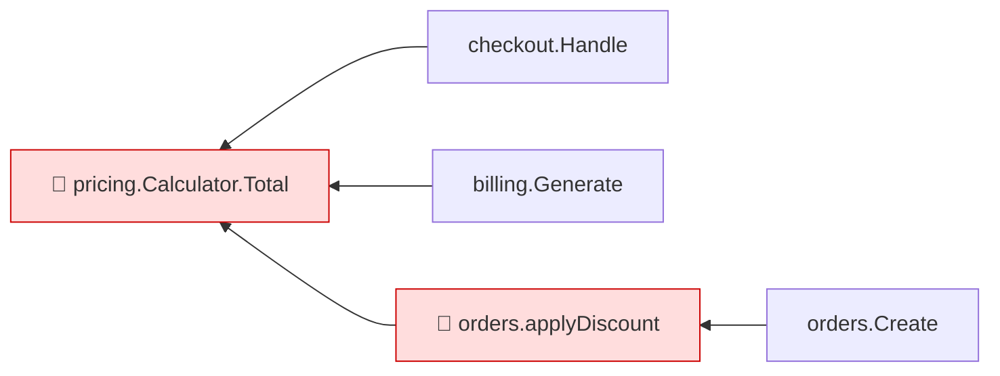

# mrimpact — Design Spec

- **Date:** 2026-11-06
- **Status:** Draft, pending author review
- **License intent:** Open source (MIT or Apache-2.0; author retains copyright, contributions under DCO/CLA)

## 1. Problem and goal

Developers increasingly merge AI-generated code without reviewing all of it. Line diffs are a poor signal of *risk*: they show what text changed, not which behaviour changed, who depends on it, or whether it is tested.

**Goal:** a CI job that, on every GitLab merge request in a Go service, posts one comment that tells the reviewer within ~5 seconds *where to look*: which functions changed, their blast radius (callers), and whether the changed lines are covered by tests.

**Non-goal:** replacing review. The tool directs attention; it does not judge correctness.

### Differentiator

The analysis is **deterministic** (Go type-checked static analysis + real coverage), not LLM opinion. Limits of the analysis are always stated in the output.

## 2. Scope

### In scope (v1)

- Language: **Go** only, one module per repository.
- Platform: **GitLab** (self-hosted or gitlab.com), via GitLab CI.
- Output: one MR note (created/updated), a Markdown artifact, and stdout.
- Local CLI use without GitLab (`mrimpact --base origin/master`).

### Out of scope (v1)

- Full-service interactive graph view.
- LLM-generated descriptions.
- Cross-service impact (HTTP/gRPC between repos).
- Monorepos / multiple `go.mod` files.
- Caching between runs.
- GitHub support (architecture keeps it a drop-in later: `internal/github`).

## 3. Context and assumptions

- First users: the author's team. Medium-sized Go services, one service per repo, on self-hosted GitLab where the author can add CI jobs.
- The MR pipeline already compiles the code and can run `go test` (optionally with `-coverprofile`).
- Posting requires a **Project Access Token** with `api` scope and at least Reporter role; the default `CI_JOB_TOKEN` cannot write MR notes.

## 4. Architecture

Single Go binary. Pure core, I/O at the edges.

```
cmd/mrimpact          CLI: flags + GitLab CI env, wires the pipeline
internal/diff         git diff BASE HEAD → []FileChange{Path, AddedLines, DeletedLines}
internal/load         go/packages (Tests: true) + SSA build
internal/symbols      changed line ranges → functions, classified new/body/signature/deleted
internal/callgraph    VTA call graph (seeded with CHA) → reverse callers up to depth N
internal/coverage     coverprofile(s) → executed-ness of added lines; static fallback
internal/risk         deterministic risk rules → red/yellow/green per function
internal/report       result model → Markdown + Mermaid (pure function)
internal/gitlab       find-or-create-or-update one MR note via REST API
```

Unit responsibilities:

- **diff** knows only git. Excludes `vendor/` and generated files (`// Code generated ... DO NOT EDIT.`). `_test.go` changes are reported separately as context, not risk.
- **symbols** maps lines to `*ssa.Function`/declarations at HEAD. Deleted functions come from parsing BASE file contents (`git show BASE:path`) with `go/ast` only. Closures are attributed to their enclosing function. Changes outside function bodies (types, package-level vars/consts, imports) are emitted as *declaration changes*.
- **callgraph** and **coverage** have no knowledge of git or GitLab.
- **risk** is a small table of rules, shared with the report footer text so code and documentation cannot drift.
- **report** is pure: model in, text out.
- **gitlab** is the only network component.

Analysis engine choice: `golang.org/x/tools` SSA + VTA call graph. Chosen over gopls/LSP (per-function queries, fragile in CI) and AST-only name matching (wrong for interfaces and same-named methods). Cost: requires the module to compile; slower (seconds–minutes on medium repos).

## 5. Data flow

Runs on `merge_request_event`, after the test job (so the coverprofile artifact is available).

1. **Inputs:** `CI_MERGE_REQUEST_DIFF_BASE_SHA` (merge-base, so target-branch changes after branching are excluded), `CI_COMMIT_SHA`, `CI_MERGE_REQUEST_IID`, `CI_PROJECT_ID`, `CI_API_V4_URL`, token from a CI variable (default name `MRIMPACT_TOKEN`). Flags override env. Job needs `GIT_DEPTH: 0` or the base SHA fetched.
2. **Diff:** `git diff -M --unified=0 BASE HEAD -- '*.go'`, with exclusions above.
3. **Load:** load module at HEAD with tests, build SSA, build VTA call graph.
4. **Affected functions:** classify each as
   - `new` — absent in BASE;
   - `body` — only body lines changed;
   - `signature` — signature changed;
   - `deleted` — present in BASE only. No caller analysis: if HEAD compiles, no remaining callers exist by construction.
5. **Blast radius:** reverse BFS from each changed function, default depth 2 (`--depth`). Test-function callers counted separately. Lists capped (top 10 + total) in output.
6. **Coverage:**
   - With `--coverprofile` (repeatable, glob allowed; profiles merged): percentage of *added lines* in each function that were executed.
   - Without a usable profile: static fallback — does any `TestXxx`/`BenchmarkXxx`/`FuzzXxx` reach the function in the call graph? Reported as `reached by test` / `not reached`.
   - The header states which source was used (`coverprofile` or `static`).
7. **Risk rules (v1):**
   - 🔴 **red:** exported function with `signature` change; **or** changed function with ≥1 non-test caller whose added lines have 0% coverage (static: not reached by any test).
   - 🟡 **yellow:** added-line coverage > 0% and < 100%; or new/changed function with no callers and no coverage (dead or not-yet-wired code).
   - 🟢 **green:** 100% of added lines covered (static: reached by a test and no rule above applies).
   - Deleted functions: listed, not risk-rated.
8. **Report:** Markdown as specified in §6.
9. **Output:** find existing note by marker `<!-- mrimpact:v1 -->` and update it; otherwise create. Always write `mrimpact-report.md` and print to stdout.
10. **Exit code:** see §7.

## 6. MR comment format

Principle: the reviewer knows where to look within 5 seconds; detail is collapsed.

Structure, in order:

1. Hidden marker `<!-- mrimpact:v1 -->`.
2. Title: `🔍 MR impact — N functions changed`.
3. Summary line: risk counts, coverage source, short base SHA. Marked **degraded** if any fallback occurred.
4. Table sorted by risk, then caller count: Risk · Function · Change · Callers (with package count) · Added-line coverage (`x % (a/b)` or static result).
5. Deleted functions line; declaration changes line; tests touched in this MR line.
6. Mermaid `graph RL` diagram: edges point **caller → changed function**; capped at ~20 nodes, prioritising highest risk; `+N not shown` when capped.
7. `<details>` with full caller lists per function (by depth level).
8. `<details>` "Limits of this analysis": reflection/dynamic registration not detected; callers in other services not visible; any skipped packages, build-tag-excluded files, stale coverage warnings.
9. Footer: risk rules legend, tool version, analysis duration.

Example:

````markdown
<!-- mrimpact:v1 -->
### 🔍 MR impact — 4 functions changed
**🔴 2 · 🟡 1 · 🟢 1** · coverage: `coverprofile` · base `a1b2c3d`

| Risk | Function | Change | Callers | Added-line coverage |
|---|---|---|---|---|
| 🔴 | `pricing.(*Calculator).Total` | signature (exported) | 14 (3 pkgs) | 0 % (0/12) |
| 🔴 | `orders.applyDiscount` | body | 5 | 0 % (0/7) |
| 🟡 | `orders.Validate` | body | 2 | 40 % (2/5) |
| 🟢 | `httpapi.formatDate` | new | 1 | 100 % (4/4) |

➖ Deleted: `legacy.OldTotal`
🧪 Tests touched in this MR: `orders/validate_test.go`



<details><summary>All callers (24)</summary>
...
</details>

<details><summary>⚠️ Limits of this analysis</summary>

- Calls via `reflect` or dynamic registration (e.g. handlers by name) are not detected.
- This repo only: callers in other services (HTTP/gRPC) are not visible.
</details>

<sub>Rules: 🔴 untested with callers, or exported signature changed · 🟡 partial, or untested with no callers · 🟢 covered · mrimpact v0.1 · 3.2 s</sub>
````

MR with no Go changes: a single line "No Go code changes", or no note (`--skip-empty`).

## 7. Error handling

Principle: informational by default; never break a pipeline because of the tool's own failures. Degrade gracefully and state every degradation in the report.

**Exit codes**

- `0` — success or degraded success (default even on internal failure, with a log warning).
- `1` — only with `--fail-on red` and red items present.
- `2` — only with `--strict` on internal failure.

**Cases**

| Situation | Behaviour |
|---|---|
| Not an MR pipeline (no `CI_MERGE_REQUEST_*`) | Local mode: stdout report, no posting. |
| Base SHA missing (shallow clone) | Try `git fetch origin <sha>`; else fail with "set `GIT_DEPTH: 0`". |
| Pure rename | No function changes reported. |
| HEAD does not compile | No partial graph. Note says "couldn't analyze: build errors in `pkg/x`". |
| Errors in some packages only | Analyze the rest; list skipped packages under Limits. |
| Changed function in build-tag-excluded file | Listed as "not analyzed (build tags)". `--tags` passes tags. |
| Changes outside functions | "Declaration changes" section; no impact analysis in v1. |
| Call graph exceeds `--timeout` (default 5m) | Diff-only report (functions + coverage, no callers), marked degraded. |
| Huge MR | Table and diagram capped; summary shows full counts. |
| Coverprofile missing | Static fallback, header says `coverage: static`. |
| Coverprofile stale/mismatched | Ignore it, static fallback, warning in report. |
| No token | Artifact + stdout; warning explaining how to add a Project Access Token. |
| GitLab 401/403 | Message: token needs `api` scope and ≥ Reporter role. |
| GitLab 5xx / network | 3 retries, exponential backoff; then give up (exit 0, artifact written). |
| Duplicate marker notes | Update the newest. |

## 8. Testing strategy

All layers except §8.4 run under `go test`, no network.

### 8.1 Unit tests

- **diff:** fixture diff text — hunks, renames, deleted files, generated-file and `vendor/` exclusion.
- **symbols:** methods (value/pointer receivers), closures → parent, generics, body vs. signature, deleted from BASE AST, declaration changes.
- **coverage:** normal profile, merged profiles, stale/mismatched profiles (must fall back, not crash).
- **risk:** table-driven, one row per rule.
- **report:** golden files `testdata/*.golden.md`, regenerated with `go test ./... -update`.

### 8.2 End-to-end fixture repos

- `testdata/<case>/base/` and `testdata/<case>/head/` modules; a helper builds a temporary git repo (init, commit base, commit head) and runs the full pipeline except posting; output compared to a golden report.
- Required cases: call through interface (must be detected), exported signature change, deleted function, function value as callback, build-tag-excluded file, HEAD fails to compile, package-level declaration change.
- Each fixture declares **expected callers**; tests assert the call graph against them. Known VTA over-approximations are recorded explicitly in the fixture, not hidden.

### 8.3 GitLab client

`httptest.Server` fake for MR notes: list with pagination, create, update, `403`, `5xx`-then-success. Asserts marker lookup, single-note update, newest-on-duplicates, retry behaviour.

### 8.4 Real-world validation (pre-registered)

- **Shadow mode:** ~20 real MRs at the author's workplace; artifact only, no posting. Per MR record: useful flag the human review missed or under-checked (reviewer agrees), false positives, runtime.
- **Success criteria (fixed before running):** ≥ 5/20 MRs with a useful flag; p90 runtime < 2 min; zero pipeline breakages caused by the tool.
- **Kill/pivot:** < 3/20 useful → rethink before adding features (graph view, LLM labels, GitHub).
- **Performance baseline:** time and peak memory on one medium-sized open-source Go service.

## 9. CI integration (reference)

```yaml
mrimpact:
  stage: report
  needs: [test]            # test job publishes coverage.out as artifact
  rules:
    - if: $CI_PIPELINE_SOURCE == "merge_request_event"
  variables:
    GIT_DEPTH: 0
  script:
    - mrimpact --coverprofile coverage.out
  artifacts:
    paths: [mrimpact-report.md]
    when: always
```

`MRIMPACT_TOKEN` is set as a masked CI/CD variable holding the Project Access Token.

## 10. Future (explicitly not v1)

Full-service graph view (HTML artifact), LLM-written labels clearly marked as interpretation, GitHub support, cross-service edges, monorepo support, queryable graph for agents (MCP / generated file).
