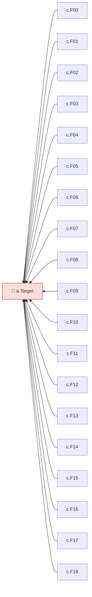

<!-- mrimpact:v1 -->
### 🔍 MR impact — 1 functions changed
**🔴 1 · 🟡 0 · 🟢 0** · coverage: `static` · base `abcdef0`

| Risk | Function | Change | Callers | Added-line coverage |
|---|---|---|---|---|
| 🔴 | `a.Target` | body | 30 | n/a |

+11 nodes not shown

All callers (30)

**`a.Target`** (30)

- depth 1: `c.F00`, `c.F01`, `c.F02`, `c.F03`, `c.F04`, `c.F05`, `c.F06`, `c.F07`, `c.F08`, `c.F09`
- and 20 more

⚠️ Limits of this analysis

- Calls via `reflect` or dynamic registration (e.g. handlers by name) are not detected.
- This repo only: callers in other services (HTTP/gRPC) are not visible.
- Functions called only from dependencies (e.g. HTTP handlers registered with net/http) or from package-level initializers show no callers.

Rules: 🔴 untested with callers, or exported signature changed · 🟡 partial, or untested with no callers · 🟢 covered · mrimpact v0.1.0 · 1.0 s
