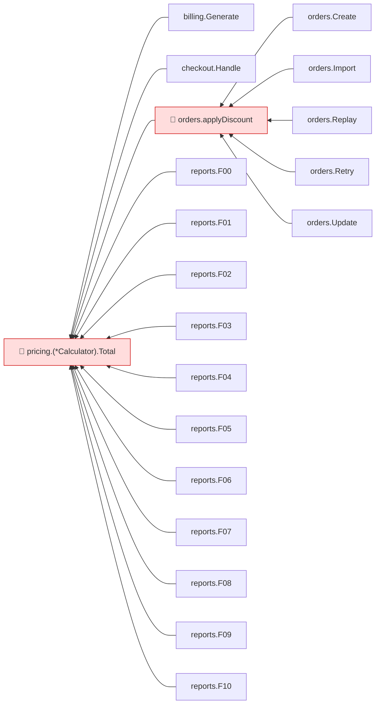

<!-- mrimpact:v1 -->
### 🔍 MR impact — 4 functions changed
**🔴 2 · 🟡 1 · 🟢 1** · coverage: `coverprofile` · base `a1b2c3d`

| Risk | Function | Change | Callers | Added-line coverage |
|---|---|---|---|---|
| 🔴 | `pricing.(*Calculator).Total` | signature (exported) | 14 (4 pkgs) | 0 % (0/12) |
| 🔴 | `orders.applyDiscount` | body | 5 | 0 % (0/7) |
| 🟡 | `orders.Validate` | body | 2 | 40 % (2/5) |
| 🟢 | `httpapi.formatDate` | new | 1 | 100 % (4/4) |

➖ Deleted: `legacy.OldTotal`
🧪 Tests touched in this MR: `orders/validate_test.go`

+5 nodes not shown

All callers (22)

**`pricing.(*Calculator).Total`** (14)

- depth 1: `billing.Generate`, `checkout.Handle`, `orders.applyDiscount`, `reports.F00`, `reports.F01`, `reports.F02`, `reports.F03`, `reports.F04`, `reports.F05`, `reports.F06`
- and 4 more

**`orders.applyDiscount`** (5)

- depth 1: `orders.Create`, `orders.Import`, `orders.Replay`, `orders.Retry`, `orders.Update`

**`orders.Validate`** (2)

- depth 1: `orders.F00`, `orders.F01`

**`httpapi.formatDate`** (1)

- depth 1: `httpapi.F00`

⚠️ Limits of this analysis

- Calls via `reflect` or dynamic registration (e.g. handlers by name) are not detected.
- This repo only: callers in other services (HTTP/gRPC) are not visible.
- Functions called only from dependencies (e.g. HTTP handlers registered with net/http) or from package-level initializers show no callers.

Rules: 🔴 untested with callers, or exported signature changed · 🟡 partial, or untested with no callers · 🟢 covered · mrimpact v0.1.0 · 3.2 s
