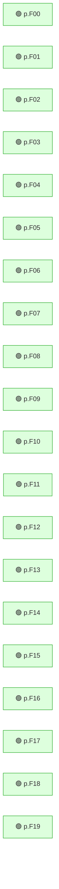

<!-- mrimpact:v1 -->
### 🔍 MR impact — 60 functions changed
**🔴 0 · 🟡 0 · 🟢 60** · coverage: `static` · base `abcdef0`

| Risk | Function | Change | Callers | Added-line coverage |
|---|---|---|---|---|
| 🟢 | `p.F00` | body | 0 | n/a |
| 🟢 | `p.F01` | body | 0 | n/a |
| 🟢 | `p.F02` | body | 0 | n/a |
| 🟢 | `p.F03` | body | 0 | n/a |
| 🟢 | `p.F04` | body | 0 | n/a |
| 🟢 | `p.F05` | body | 0 | n/a |
| 🟢 | `p.F06` | body | 0 | n/a |
| 🟢 | `p.F07` | body | 0 | n/a |
| 🟢 | `p.F08` | body | 0 | n/a |
| 🟢 | `p.F09` | body | 0 | n/a |
| 🟢 | `p.F10` | body | 0 | n/a |
| 🟢 | `p.F11` | body | 0 | n/a |
| 🟢 | `p.F12` | body | 0 | n/a |
| 🟢 | `p.F13` | body | 0 | n/a |
| 🟢 | `p.F14` | body | 0 | n/a |
| 🟢 | `p.F15` | body | 0 | n/a |
| 🟢 | `p.F16` | body | 0 | n/a |
| 🟢 | `p.F17` | body | 0 | n/a |
| 🟢 | `p.F18` | body | 0 | n/a |
| 🟢 | `p.F19` | body | 0 | n/a |
| 🟢 | `p.F20` | body | 0 | n/a |
| 🟢 | `p.F21` | body | 0 | n/a |
| 🟢 | `p.F22` | body | 0 | n/a |
| 🟢 | `p.F23` | body | 0 | n/a |
| 🟢 | `p.F24` | body | 0 | n/a |
| 🟢 | `p.F25` | body | 0 | n/a |
| 🟢 | `p.F26` | body | 0 | n/a |
| 🟢 | `p.F27` | body | 0 | n/a |
| 🟢 | `p.F28` | body | 0 | n/a |
| 🟢 | `p.F29` | body | 0 | n/a |
| 🟢 | `p.F30` | body | 0 | n/a |
| 🟢 | `p.F31` | body | 0 | n/a |
| 🟢 | `p.F32` | body | 0 | n/a |
| 🟢 | `p.F33` | body | 0 | n/a |
| 🟢 | `p.F34` | body | 0 | n/a |
| 🟢 | `p.F35` | body | 0 | n/a |
| 🟢 | `p.F36` | body | 0 | n/a |
| 🟢 | `p.F37` | body | 0 | n/a |
| 🟢 | `p.F38` | body | 0 | n/a |
| 🟢 | `p.F39` | body | 0 | n/a |
| 🟢 | `p.F40` | body | 0 | n/a |
| 🟢 | `p.F41` | body | 0 | n/a |
| 🟢 | `p.F42` | body | 0 | n/a |
| 🟢 | `p.F43` | body | 0 | n/a |
| 🟢 | `p.F44` | body | 0 | n/a |
| 🟢 | `p.F45` | body | 0 | n/a |
| 🟢 | `p.F46` | body | 0 | n/a |
| 🟢 | `p.F47` | body | 0 | n/a |
| 🟢 | `p.F48` | body | 0 | n/a |
| 🟢 | `p.F49` | body | 0 | n/a |

_… and 10 more_

+40 nodes not shown

All callers (0)

⚠️ Limits of this analysis

- Calls via `reflect` or dynamic registration (e.g. handlers by name) are not detected.
- This repo only: callers in other services (HTTP/gRPC) are not visible.
- Functions called only from dependencies (e.g. HTTP handlers registered with net/http) or from package-level initializers show no callers.

Rules: 🔴 untested with callers, or exported signature changed · 🟡 partial, or untested with no callers · 🟢 covered · mrimpact v0.1.0 · 1.0 s
