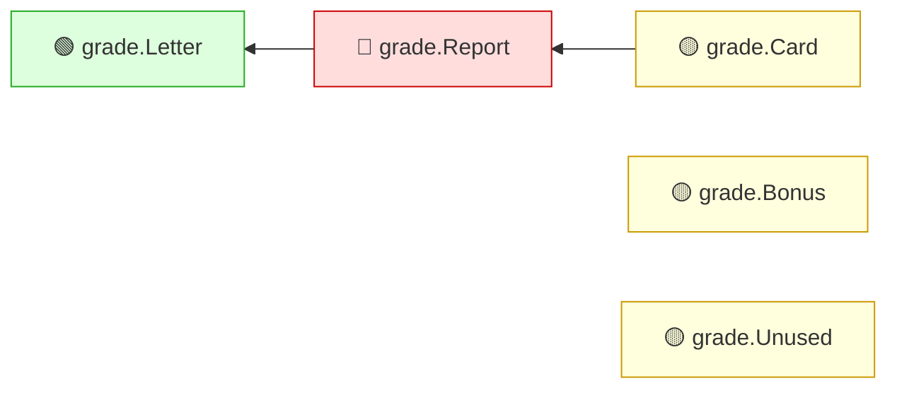

<!-- mrimpact:v1 -->
### 🔍 MR impact — 5 functions changed
**🔴 1 · 🟡 3 · 🟢 1** · coverage: `coverprofile` · base `0000000`

| Risk | Function | Change | Callers | Added-line coverage |
|---|---|---|---|---|
| 🔴 | `grade.Report` | body | 1 | 0 % (0/2) |
| 🟡 | `grade.Bonus` | new | 0 | 80 % (4/5) |
| 🟡 | `grade.Card` | new | 0 | 0 % (0/3) |
| 🟡 | `grade.Unused` | new | 0 | 0 % (0/2) |
| 🟢 | `grade.Letter` | body | 2 | 100 % (3/3) |

🧪 Tests touched in this MR: `grade/grade_test.go`

All callers (3)

**`grade.Report`** (1)

- depth 1: `grade.Card`

**`grade.Letter`** (2)

- depth 1: `grade.Report`
- depth 2: `grade.Card`

⚠️ Limits of this analysis

- Calls via `reflect` or dynamic registration (e.g. handlers by name) are not detected.
- This repo only: callers in other services (HTTP/gRPC) are not visible.
- Functions called only from dependencies (e.g. HTTP handlers registered with net/http) or from package-level initializers show no callers.

Rules: 🔴 untested with callers, or exported signature changed · 🟡 partial, or untested with no callers · 🟢 covered · mrimpact v0.1.0 · 0.0 s
