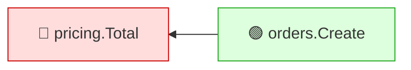

<!-- mrimpact:v1 -->
### 🔍 MR impact — 2 functions changed
**🔴 1 · 🟡 0 · 🟢 1** · coverage: `static` · base `0000000`

| Risk | Function | Change | Callers | Added-line coverage |
|---|---|---|---|---|
| 🔴 | `pricing.Total` | signature (exported) | 1 | reached by test |
| 🟢 | `orders.Create` | body | 0 | reached by test |

All callers (1)

**`pricing.Total`** (1)

- depth 1: `orders.Create`

⚠️ Limits of this analysis

- Calls via `reflect` or dynamic registration (e.g. handlers by name) are not detected.
- This repo only: callers in other services (HTTP/gRPC) are not visible.
- Functions called only from dependencies (e.g. HTTP handlers registered with net/http) or from package-level initializers show no callers.

Rules: 🔴 untested with callers, or exported signature changed · 🟡 partial, or untested with no callers · 🟢 covered · mrimpact v0.1.0 · 0.0 s
