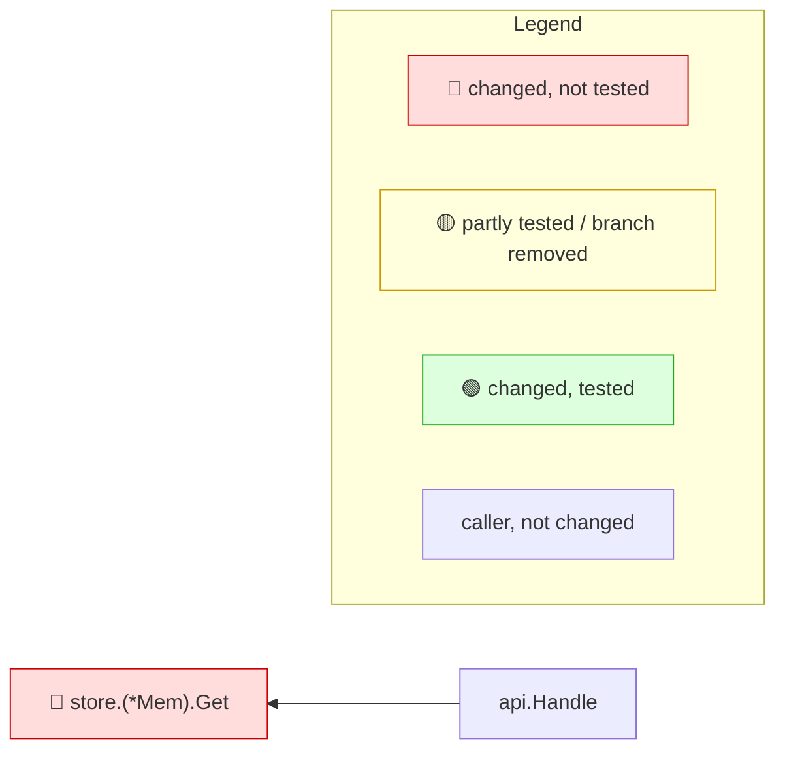

<!-- mrimpact:v1 -->
### 🔍 MR impact — 1 functions changed
**🔴 1 · 🟡 0 · 🟢 0** · coverage: `static` · base `0000000`

| Risk | Function | Change | Callers | Entry points | Added-line coverage |
|---|---|---|---|---|---|
| 🔴 | `store.(*Mem).Get` | body | 2 (2 pkgs) | api `api.Handle`, api `store.(*Mem).Get` +1 | not reached |

**How to read the diagram:** coloured boxes are functions this MR changed (🔴 not tested · 🟡 partly tested or a branch removed · 🟢 tested); plain boxes are callers the MR did not change; an arrow points from a caller to the function it calls; a dashed arrow means the function is passed as a callback (registered) and called through it. Every caller is listed under *All callers*.

All callers (2)

**`store.(*Mem).Get`** (2)

- depth 1: `api.Handle`
- depth 2: `main.main`

⚠️ Limits of this analysis

- Calls via `reflect` or dynamic registration (e.g. handlers by name) are not detected.
- This repo only: callers in other services (HTTP/gRPC) are not visible.
- Functions called only from dependencies (e.g. HTTP handlers registered with net/http) or from package-level initializers show no callers; where such a function is registered is listed under Registered.
- Now unused: uses through `reflect`, `//go:linkname` or other repositories are not seen; exported methods, and exported functions of packages other modules can import, are never listed.

Rules: 🔴 untested with callers, or exported signature changed in an importable package · 🟡 partial, untested with no callers, or a branch removed · 🟢 covered (no added lines: reached by a test) · wiring (straight-line setup) at most 🟡 · sensitive and untested 🔴 · mrimpact test · 0.0 s
