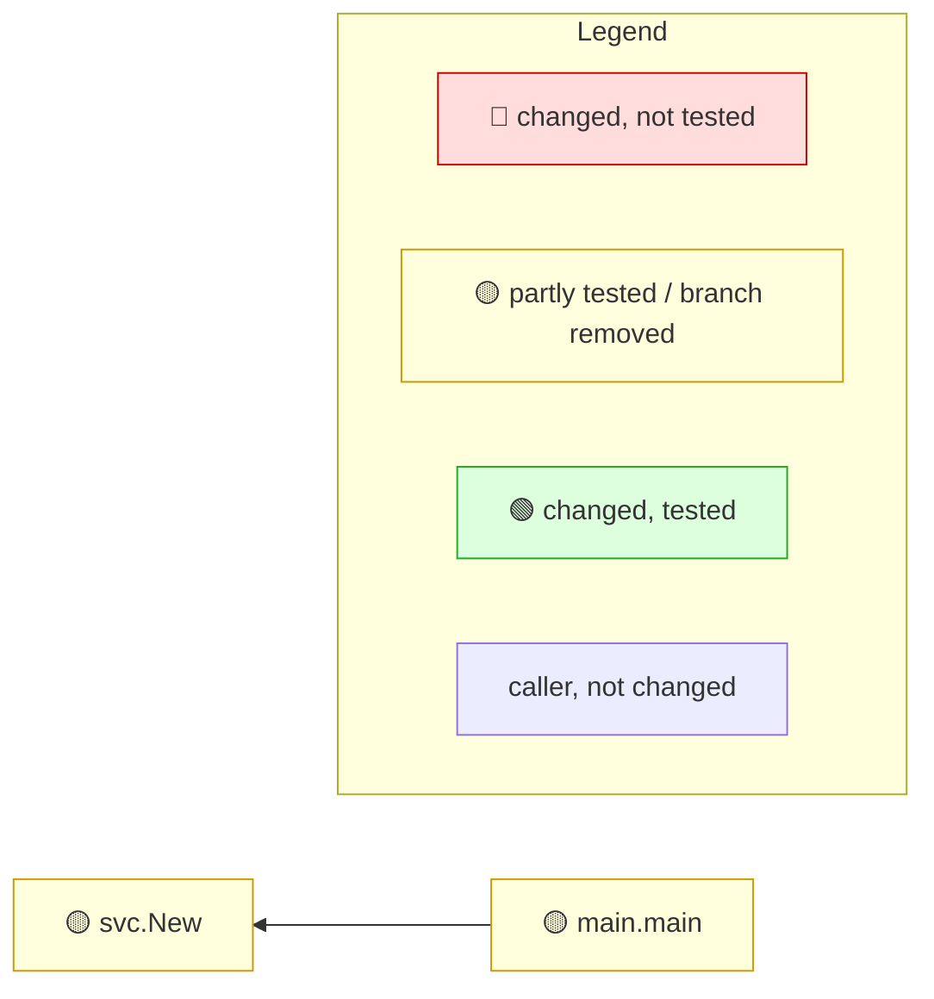

<!-- mrimpact:v1 -->
### 🔍 MR impact — 6 functions changed
**🔴 0 · 🟡 2 · 🟢 0** · coverage: `coverprofile` · base `0000000`\
+4 new functions folded into 1 groups

| Risk | Function | Change | Callers | Added-line coverage |
|---|---|---|---|---|
| 🟡 | `svc.New` | new · +4 | 1 | 79 % (19/24) · 1 untested |
| 🟡 | `main.main` | body · wiring | 0 | no added lines · not reached |

svc.New +4 new

- 🟢 `svc.(*S).apply` · new · 100 % (4/4) — `svc/svc.go`
- 🔴 `svc.fmt` · new · 0 % (0/5) — `svc/svc.go`
- 🟢 `svc.load` · new · 100 % (5/5) — `svc/svc.go`
- 🟢 `svc.price` · new · 100 % (5/5) — `svc/svc.go`

📝 Declarations changed: `type S in svc/svc.go`

**How to read the diagram:** coloured boxes are functions this MR changed (🔴 not tested · 🟡 partly tested or a branch removed · 🟢 tested); plain boxes are callers the MR did not change; an arrow points from a caller to the function it calls; a dashed arrow means the function is passed as a callback (registered) and called through it. Every caller is listed under *All callers*.

All callers (1)

**`svc.New`** (1)

- depth 1: `main.main`

⚠️ Limits of this analysis

- Calls via `reflect` or dynamic registration (e.g. handlers by name) are not detected.
- This repo only: callers in other services (HTTP/gRPC) are not visible.
- Functions called only from dependencies (e.g. HTTP handlers registered with net/http) or from package-level initializers show no callers; where such a function is registered is listed under Registered.
- Now unused: uses through `reflect`, `//go:linkname` or other repositories are not seen; exported methods, and exported functions of packages other modules can import, are never listed.

Rules: 🔴 untested with callers, or exported signature changed in an importable package · 🟡 partial, untested with no callers, or a branch removed · 🟢 covered (no added lines: reached by a test) · wiring (straight-line setup) at most 🟡 · mrimpact v0.2.0 · 0.0 s
