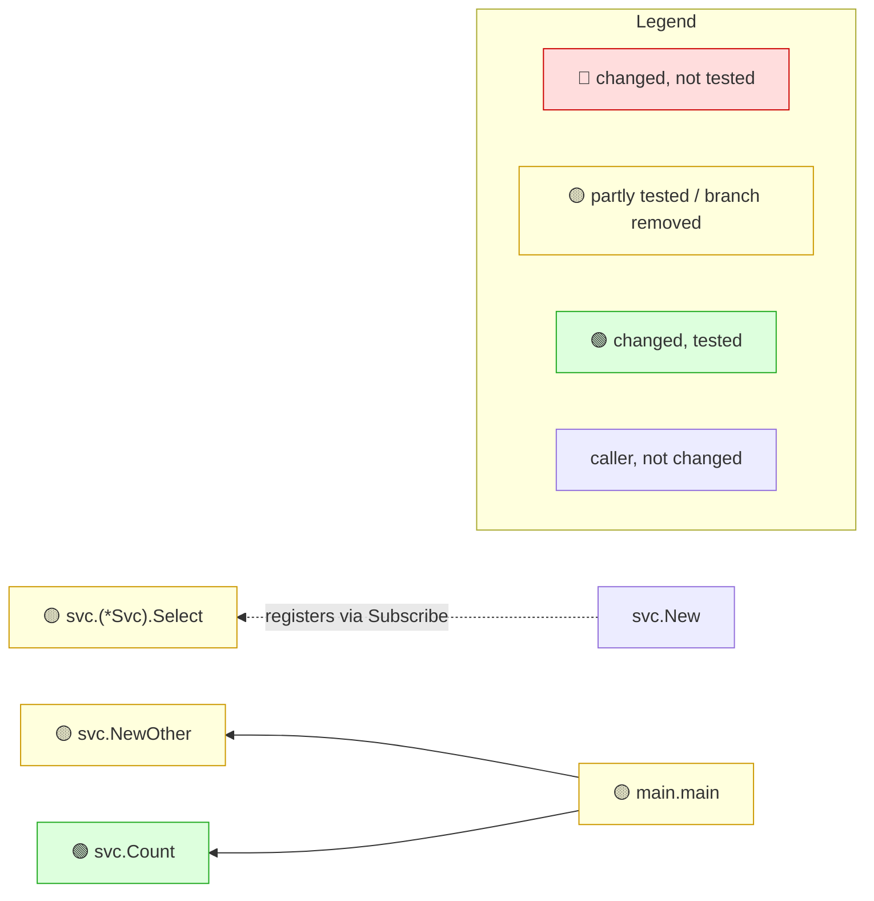

<!-- mrimpact:v1 -->
### 🔍 MR impact — 4 functions changed
**🔴 0 · 🟡 3 · 🟢 1** · coverage: `static` · base `0000000`

↪️ **Removed `case`, value still exists** — these values now take another path (1):

- `case Hedge` in `svc.(*Svc).Select` — now matches no case — `internal/svc/svc.go:26`

🪦 **Now unused** — nothing reachable calls these after this MR (2):

- `svc.Topics` — `internal/svc/svc.go:43`
- `svc.topicList` — `internal/svc/svc.go:45` (only reached through `svc.Topics`)

🧫 **Now only used by tests** — no production path reaches these after this MR (1):

- `svc.topics` — `internal/svc/svc.go:40`

⚙️ **Config no longer read** — remove the field and the setting from deployments (1):

- `conf.Config.AdminPort` `envconfig:"ADMIN_PORT"` — `internal/conf/conf.go:6`

🧩 **Generated code no longer used** — remove it from its source (.sql, .proto, interface) and regenerate (1):

- `db.(*Queries).GetTopic` — `internal/db/queries.go:15`

🔌 **Registrations removed, no replacement** — these calls no longer get a handler; check each is intended (1, positions in base):

- `Subscribe("hedge", …)` → `svc.onHedge` — `internal/svc/other.go:12`

All changes shown are reached from: main

| Risk | Function | Change | Callers | Registered | Entry points | Added-line coverage |
|---|---|---|---|---|---|---|
| 🟡 | `svc.(*Svc).Select` | body (branch removed) | 2 (2 pkgs) | `Subscribe("select", …)` | `Subscribe("select", …)` | reached by test |
| 🟡 | `svc.NewOther` | body · wiring | 1 |  | — | not reached |
| 🟡 | `main.main` | body · wiring | 0 |  | — | not reached |
| 🟢 | `svc.Count` | signature (exported) | 1 |  | — | reached by test |

➖ Deleted: `svc.onHedge`, `svc.hedge`, `svc.Admin`

🧪 Tests touched in this MR: `internal/svc/svc_test.go`

**How to read the diagram:** coloured boxes are functions this MR changed (🔴 not tested · 🟡 partly tested or a branch removed · 🟢 tested); plain boxes are callers the MR did not change; an arrow points from a caller to the function it calls; a dashed arrow means the function is passed as a callback (registered) and called through it. Every caller is listed under *All callers*.

All callers (4)

**`svc.(*Svc).Select`** (2)

- registered: `Subscribe("select", …)` — `internal/svc/svc.go:11`
- depth 1: `bus.(*Bus).Subscribe`
- depth 2: `svc.New`

**`svc.NewOther`** (1)

- depth 1: `main.main`

**`svc.Count`** (1)

- depth 1: `main.main`

⚠️ Limits of this analysis

- Calls via `reflect` or dynamic registration (e.g. handlers by name) are not detected.
- This repo only: callers in other services (HTTP/gRPC) are not visible.
- Functions called only from dependencies (e.g. HTTP handlers registered with net/http) or from package-level initializers show no callers; where such a function is registered is listed under Registered.
- Now unused: uses through `reflect`, `//go:linkname` or other repositories are not seen; exported methods, and exported functions of packages other modules can import, are never listed.

Rules: 🔴 untested with callers, or exported signature changed in an importable package · 🟡 partial, untested with no callers, or a branch removed · 🟢 covered (no added lines: reached by a test) · wiring (straight-line setup) at most 🟡 · sensitive and untested 🔴 · mrimpact v0.2.0 · 0.0 s
